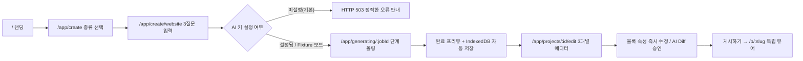
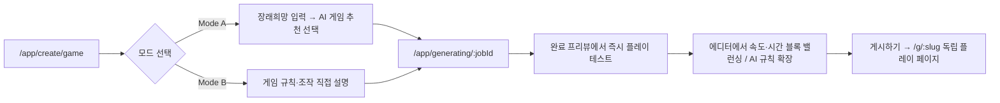

# Dream Studio 2.0 — User Flows

## 1. 핵심 학생 창작 흐름 (웹사이트)

## 2. 핵심 학생 창작 흐름 (게임)

## 3. 버전 관리 및 안전 복구 흐름
- 블록 속성 변경 또는 AI Diff 승인 시 자동으로 새 `revision` 스냅샷이 `project.versions`에 기록됩니다.
- 좌측 `버전` 탭에서 과거 버전을 선택해 **이 버전으로 복원**하면 `title`, `source.files`, `componentGraph`가 일괄 동기화되며 새 리비전으로 저장됩니다.
